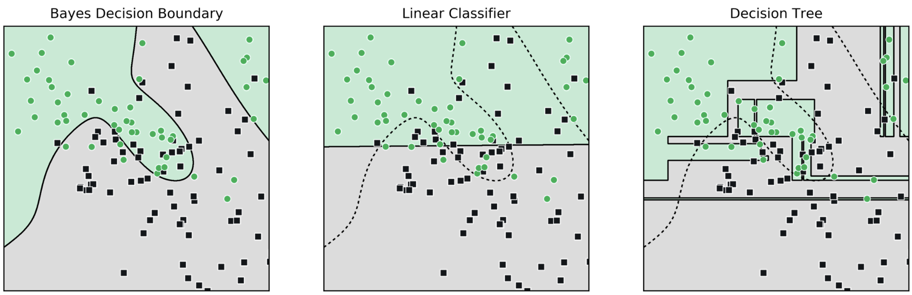

# Site Style Guide

How the IDS 705 site's look is set up, and how to change, adjust, or revert each part.

The site currently uses these choices from the [style options page](https://claude.ai/artifact/9vJ5phEPcfStRguP2HqxdS):

| Choice | Current setting |
|---|---|
| A · Links | **A2** Kelly green links, with a Kelly marker beside the current sidebar page |
| B · Navbar | **B2** White bar with a 3px Kelly line along the top |
| C · Schedule section rows | **C1** Dark gray bar (unchanged from before) |
| D · Callouts | **D2** Kelly for tips, quiet gray-green for notes |
| E · Typeface | **E3** IBM Plex Sans |
| F · Dark mode | **F2** Light and dark, following each visitor's system setting, with a toggle in the navbar |
| G · Homepage demo | Interactive classifier in place of the static figure (not from the options page) |

---

## Where Things Live

| File | What it controls |
|---|---|
| `theme-light.scss` | Light-mode colors: brand greens, links, navbar, callouts |
| `theme-dark.scss` | Dark-mode colors: the same variables, plus page background, text, and line colors |
| `theme.scss` | Shared by both modes: the font, the navbar's green line, the sidebar marker, the phone-size navbar title |
| `styles.css` | Schedule table colors. The top of the file has a light block (`:root`) and a dark block (`body.quarto-dark`) |
| `_quarto.yml` (under `format: html:`) | Which theme files load, whether dark mode exists, whether it follows the visitor's system setting (`respect-user-color-scheme`), and site-wide options such as callout appearance |
| `img/favicon.svg` | The browser-tab icon |
| `_ml-demo.qmd` | The interactive classifier demo at the top of the homepage: its layout, plot colors, and code (section G) |

Most changes are a one-line edit in `theme-light.scss`, with a matching edit in `theme-dark.scss`. The two files use the same variable names on purpose, so keep them in step.

---

## Seeing Your Changes

1. Run `quarto preview` to see changes live while you edit, or `quarto render` to rebuild `docs/`.
2. Commit the changed source files **and** `docs/`. GitHub Pages serves `docs/`.
3. Browsers cache stylesheets and favicons. If a change doesn't show up, do a hard refresh or open a private window.

**Testing dark mode.** Click the toggle in the navbar, or switch your computer's system appearance to dark. Once you click the toggle, your browser remembers that choice and stops following the system setting. To make your browser follow the system setting again, clear the site's data, or run this in the browser console:

```js
localStorage.removeItem("quarto-color-scheme");
```

**Dropbox.** Rendering inside a Dropbox folder can produce "conflicted copy" files in `docs/`, because Quarto rewrites files faster than Dropbox syncs them. If they appear, delete them and render again, or pause Dropbox syncing while you render. They're listed in `.gitignore`, so they won't be committed by accident.

---

## A · Links

**Current:** Kelly 700 links (`#2F7A0E` in light mode, `#7ACF4B` in dark mode), and a bold green current page with a Kelly bar in the sidebar.

**Adjust the color:** change `$kelly-700` (links) and `$kelly-800` (hover) in `theme-light.scss`, and the same two variables in `theme-dark.scss`. Link text needs at least 4.5:1 contrast against the page background.

**No underlines:** links aren't underlined because `$link-decoration: none;` is set in `theme.scss`. Quarto 1.8 and later underline every link by default (navbar, sidebar, footer, and page text); deleting that line brings Quarto's default back.

**Underline links in page text only (option A3):** keep `$link-decoration: none;` and add this to the end of `theme.scss`. Note that it also underlines the breadcrumb at the top of each page.

```scss
// Underline links in page content
#quarto-document-content a {
  text-decoration: underline;
  text-decoration-color: rgba($link-color, 0.4);
  text-underline-offset: 3px;
}
```

**Remove the sidebar marker:** delete the `div.sidebar-item-container .sidebar-link.active { ... }` block in `theme.scss`. The current page then shows as colored text only.

**Revert to blue links (option A1):**

- `theme-light.scss`: delete the `$primary`, `$link-color`, and `$link-hover-color` lines.
- `theme-dark.scss`: replace those three lines with `$link-color: #7DB3EE;`. Cosmo's default blue is too dark to read on the dark background.
- `theme.scss`: delete the sidebar block described above.

---

## B · Navbar

**Current:** white bar (dark-mode background in dark mode), with a 3px Kelly line along the top and a thin line underneath.

**Remove the green line, or change its thickness:** edit `border-top: 3px solid $kelly;` in `theme.scss`. Delete the line to remove it, or change `3px`.

**Deep green bar (option B3):** set these in **both** theme files. You may also want to delete the `border-top` line in `theme.scss`.

```scss
$navbar-bg: #1F4F09;
$navbar-fg: #FFFFFF;
```

**Pale green bar (option B4):**

```scss
// theme-light.scss
$navbar-bg: #EDF7E8;
$navbar-fg: #256309;

// theme-dark.scss
$navbar-bg: #1A2617;
$navbar-fg: #A8DE88;
```

**Revert to the original light gray (option B1):** use these values and delete the `border-top` line in `theme.scss`. Keep the values explicit rather than deleting the lines: deleting them lets Quarto pick its own navbar color.

```scss
// theme-light.scss
$navbar-bg: #F8F9FA;
$navbar-fg: #545555;

// theme-dark.scss
$navbar-bg: #1B201B;
$navbar-fg: #C9D1C6;
```

**Navbar title on phones:** the `@media (max-width: 575.98px)` rule in `theme.scss` shrinks the title so it fits beside the dark-mode toggle. If you change the title in `_quarto.yml` (`navbar: title:`), check it at phone width.

---

## C · Schedule Section Rows

**Current:** the original dark gray bar (`#495057`; `#3b4247` in dark mode).

All section-row settings are at the top of `styles.css`: `--sched-module-bg`, `--sched-module-fg`, and `--sched-module-edge`. Each mode has its own block. `--sched-module-edge` is set only in the light block, and dark mode uses the same value unless you add it to the dark block.

**Deep green bar (option C2):** set `--sched-module-bg: #256309;` in both blocks. Keep the text white.

**Tinted band (option C3):**

```css
/* :root (light) block */
--sched-module-bg:   #EDF7E8;
--sched-module-fg:   #256309;
--sched-module-edge: 4px solid #4CBB17;

/* body.quarto-dark block */
--sched-module-bg: #1c2918;
--sched-module-fg: #a8de88;
```

**Ruled heading (option C4):** set `--sched-module-bg: transparent;` in both blocks, and `--sched-module-fg` to `#2F7A0E` (light) and `#8fd967` (dark). Then add this to the end of `styles.css`:

```css
/* Module rows as small green headings with a Kelly rule */
table.schedule > tbody > tr.module > td {
  border-bottom: 2px solid #4CBB17;
  text-transform: uppercase;
  letter-spacing: .06em;
  font-size: .85rem;
}
```

The same two blocks also hold the colors for the "Due", "Exam", and gray tags and their row tints. Change them the same way. Keep green out of these: orange means due and red means exam, and green would read as "done".

---

## D · Callouts

**Current:** tips (`::: {.callout-tip}`) use Kelly; notes (`::: {.callout-note}`) use a quiet gray-green, `#8C9A88`. Quarto works out the tinted header and icon color from these automatically, in both modes.

**Adjust:** change `$callout-color-tip` and `$callout-color-note` in both theme files. Other callout types can be set the same way: `$callout-color-important`, `$callout-color-warning`, and `$callout-color-caution`.

**Minimal callouts, with no tinted header (option D3):** add one line under `format: html:` in `_quarto.yml`:

```yaml
    callout-appearance: simple
```

**Revert to Quarto's default colors (option D1):** delete the two `$callout-color-...` lines in both theme files.

---

## E · Typeface

**Current:** IBM Plex Sans for text and IBM Plex Mono for code. Both are set by three variables at the top of `theme.scss`.

**Switch to Inter (option E2):** in `theme.scss`, change these two lines:

```scss
$web-font-path: "https://fonts.googleapis.com/css2?family=Inter:wght@300;400;600;700&display=swap";
$font-family-sans-serif: "Inter", system-ui, -apple-system, "Segoe UI", Roboto, "Helvetica Neue", Arial, sans-serif;
```

**Switch to Atkinson Hyperlegible (option E4):**

```scss
$web-font-path: "https://fonts.googleapis.com/css2?family=Atkinson+Hyperlegible:ital,wght@0,400;0,700;1,400&display=swap";
$font-family-sans-serif: "Atkinson Hyperlegible", system-ui, -apple-system, "Segoe UI", Roboto, "Helvetica Neue", Arial, sans-serif;
```

If you switch away from IBM Plex, the code font stays IBM Plex Mono only while `$web-font-path` still loads it. Either add `&family=IBM+Plex+Mono:wght@400;500` to the new URL, or delete the `$font-family-monospace` line.

**Revert to Source Sans, Cosmo's default (option E1):** delete all three variables (`$web-font-path`, `$font-family-sans-serif`, `$font-family-monospace`).

**Any other Google Font:** choose it at fonts.google.com, copy its `css2?family=...` URL into `$web-font-path`, and put its name first in `$font-family-sans-serif`.

---

## F · Dark Mode

**Current:** a light theme and a dark theme. Visitors see whichever matches their system setting until they click the navbar toggle; after that, their choice sticks.

**Adjust dark colors:** edit `theme-dark.scss` (page background, text, lines, links, navbar, callouts) and the `body.quarto-dark` block at the top of `styles.css` (schedule colors).

**Always start in light mode, but keep the toggle:** delete the `respect-user-color-scheme: true` line in `_quarto.yml`. (This setting needs Quarto 1.7 or later.)

**Turn dark mode off entirely (option F1):** in `_quarto.yml`, replace the two-line `theme:` block with:

```yaml
    theme: [cosmo, theme.scss, theme-light.scss]
```

Then delete the `respect-user-color-scheme` line. The toggle disappears. You can keep `theme-dark.scss` for later, or delete it.

---

## G · Homepage Demo

**Current:** an interactive classifier at the top of the homepage, in place of the static figure `img/decision-boundaries.png`. Visitors choose a dataset and a model (k-nearest neighbors, decision tree, or logistic regression), move the flexibility slider, and watch the decision boundary, the training and test accuracy, and an accuracy-at-every-setting chart change. The best possible (Bayes) accuracy is shown for comparison, and its boundary can be drawn as a dashed line.

**Where it lives:** everything (HTML, CSS, and JavaScript) is in `_ml-demo.qmd`. `index.qmd` pulls it in with one line: ``. The underscore keeps Quarto from rendering it as its own page. It runs entirely in the browser, with no libraries and no network requests.

**Size:** it's kept compact so the course description stays near the top of the page. On a 1440×900 screen the demo is about 450px tall, including a three-line caption, and "Course Summary" starts about 735px down.

- The plot's size is `--mld-plot-max` at the top of the `<style>` block, currently `min(360px, 50vh)`. Raise it for a bigger plot, at the cost of pushing the description down. The controls beside the plot are sized to stay about as tall as the plot.
- The caption under the demo ("Interactive figure: ...") is the `<p class="mld-caption">` near the end of the HTML. It also explains the filled (training) and hollow (test) points.
- On phones the accuracy chart is hidden to save space.
- The noise slider, the test-point and best-possible checkboxes, and "New training sample" sit under the collapsed "More options".

**Logistic regression:** the polynomial degree goes up to 15, high enough to overfit clearly. On the default data, test accuracy peaks at about 91% around degree 3–4 and falls to about 82% at degree 15, while training accuracy reaches 99%. The features are Chebyshev polynomials. They describe exactly the same curves as plain powers like x²y, but every term stays on the same scale, so high degrees can actually be used. The comments in `fitLogistic` explain this.

**Colors:**

- The buttons, sliders, and checkboxes take the site's link color automatically (`--bs-primary`), in both modes.
- The plot and chart colors are the `--mld-*` variables at the top of the `<style>` block in `_ml-demo.qmd`. There's one block for light mode (`#ml-demo`) and one for dark mode (`body.quarto-dark #ml-demo`).
- To change a color for this site only, without editing the demo file, set the same variable in `styles.css`. For example:

```css
#ml-demo { --mld-region-a: #d8f0c8; }
body.quarto-dark #ml-demo { --mld-region-a: #2c4a20; }
```

- Use solid colors (hex or `rgb()`). The demo builds its shading pixel by pixel and ignores transparency.
- Every point and line color is at least 3.7:1 against both region colors, in both modes. Keep at least 3:1 if you change them.

**Starting state:** the demo opens on Moons at noise 0.65 with k-NN at k = 1:

- 100% training accuracy but 86% test, so it's visibly overfit.
- Test accuracy peaks at 92% around k = 9 to 11, which matches the best possible 92%.

These numbers come from the `defaults()` function in `_ml-demo.qmd`, where a comment explains how the seeds were chosen. If you change the noise or seeds there, also update the caption at the top of the demo if it no longer fits.

**Test accuracy:** test accuracy is measured on 2,000 held-out points, so it's a stable estimate; only 60 of them are drawn on the plot.

**Go back to the static figure:** in `index.qmd`, replace the include line with:

```markdown
{fig-alt="Three panels showing decision boundaries on the same two-class dataset: the Bayes decision boundary, a linear classifier, and a decision tree."}
```

Keep `img/decision-boundaries.png` either way. `_quarto.yml` uses it as the link-preview image, and the demo shows it automatically if JavaScript is off or the demo hits an error.

**Use it on another site (such as IDS 542):**

1. Copy `_ml-demo.qmd` next to that site's `index.qmd`, and add the include line where the demo should appear.
2. Check that the site has `img/decision-boundaries.png` for the fallback, or change `data-fallback-src` and the `<noscript>` image in the demo file.
3. The controls take that site's link color. On plain Cosmo this is blue; to keep them green, add `#ml-demo { --mld-accent: #2F7A0E; --mld-accent-rgb: 47, 122, 14; }` to its `styles.css`.

**Testing changes to the code:** the pure computation (data generation, models, and Bayes classifier) sits between the `[CORE-START]` and `[CORE-END]` comments. It doesn't touch the web page, so it can be run on its own, for example with macOS's built-in JavaScript shell (`/System/Library/Frameworks/JavaScriptCore.framework/Versions/Current/Helpers/jsc`).

---

## Revert Everything

To go back to the plain Cosmo look the site had before these changes:

1. In `_quarto.yml`, replace the `theme:` block with `theme: cosmo`, and delete the `respect-user-color-scheme` line.
2. Optionally delete `theme.scss`, `theme-light.scss`, and `theme-dark.scss`.
3. Render.

`styles.css` keeps working as it is. Its light-mode colors are the same ones the schedule used before. Once these changes are committed, you can also restore any earlier version of a single file with `git checkout <commit> -- <file>`.

---

## Palette Reference

| Name | Light mode | Dark mode | Used for |
|---|---|---|---|
| Kelly | `#4CBB17` | `#4CBB17` | Accents only: the navbar line, sidebar marker, tip callouts, and favicon. At 2.5:1 on white it is too light for text. |
| Kelly 700 | `#2F7A0E` | `#7ACF4B` | Links and the current sidebar page (5.4:1 on white) |
| Kelly 800 | `#256309` | `#9BDD73` | Link hover |
| Note gray-green | `#8C9A88` | `#8C9A88` | Note callouts |
| Page background | Cosmo white | `#131713` | |
| Body text | Cosmo `#373A3C` | `#D9DFD6` | |
| Lines | Cosmo default | `#343B33` | Heading underlines, callout outlines, table rules, navbar edge |

When you change a light-mode color, check its dark-mode counterpart. Text should keep at least 4.5:1 contrast against its background in both modes.
